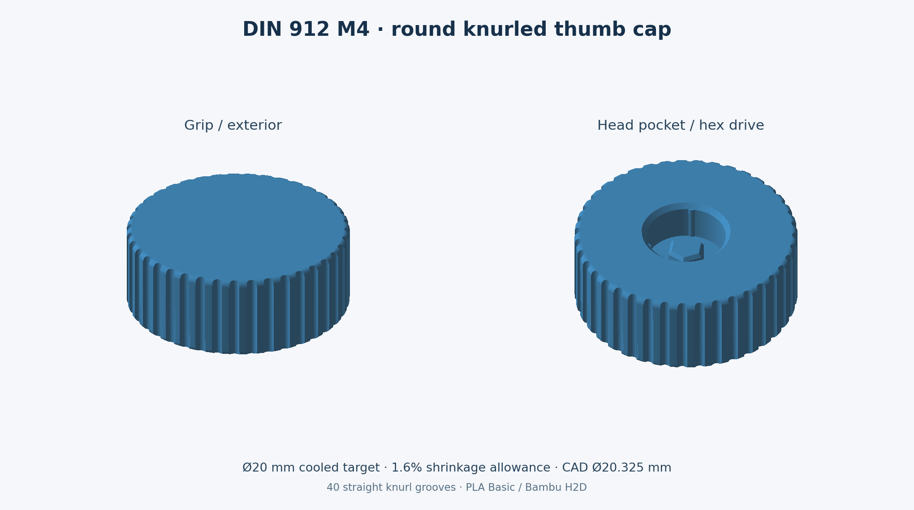

# DIN 912 M4 knurled press-on screw cap

A round knob with a **20 mm cooled target diameter**, 40 straight knurl grooves, and rounded outer edges. It presses onto the exposed head of a standard DIN 912 M4 socket-head screw. Three internal ribs retain the cap; a hex peg engages the 3 mm socket for tool-free adjustment.

## Download

- [Main STEP model](M4_DIN912_thumb_cap.step) — solid CAD in millimetres.
- [Main STL model](M4_DIN912_thumb_cap.stl) — import into Bambu Studio.
- [Fit-test STEP](M4_fit_test.step) / [STL](M4_fit_test.stl) — smaller cap with identical socket and retention geometry.
- [Printing notes and dimensions](PRINT_NOTES.txt).

Open a file on GitHub and click **Download raw file**, or use **Code → Download ZIP** for the whole package. These models replace the earlier wing handle and 0.2% shrinkage allowance.

## Dimensions and shrinkage

All exported geometry includes the requested **1.6% linear PLA shrinkage compensation**, applied uniformly in X, Y and Z using a scale factor of `1 / 0.984 = 1.01626016`.

| Feature | Cooled design target | Compensated CAD dimension |
| --- | ---: | ---: |
| Maximum knob diameter | 20.000 mm | 20.325 mm |
| Overall height | 7.600 mm | 7.724 mm |
| Head pocket diameter | 7.180 mm | 7.297 mm |
| Head pocket depth | 3.600 mm | 3.659 mm |
| Effective rib diameter | 6.920 mm | 7.033 mm |
| Hex peg across flats | 2.940 mm | 2.988 mm |
| Hex insertion depth | 1.800 mm | 1.829 mm |

The grip has 40 axial grooves, each 0.90 mm in cutter diameter and approximately 0.50 mm deep radially before shrinkage compensation. The remaining lands provide a straight knurled texture. The knob stays within the original 30 mm diameter limit.

## Bambu H2D / PLA Basic

Use a 0.4 mm nozzle, calibrated PLA Basic profile, 0.16 mm layers, 4 walls, 5 top/bottom layers, and 30–40% infill. Place the flat exterior face on the bed with the pocket and peg pointing up. No supports required.

**Print at 100% scale. Do not apply another shrinkage scale in Bambu Studio or the filament profile.** The files already include the full 1.6% allowance. This is the requested assumption, not a measured material calibration.

Print the fit-test cap first and let it cool completely. Nominal cooled interference is 0.04 mm radially at the ribs on a 7.00 mm head. Printer calibration, hole-size bias and screw tolerances affect the actual fit. If the material shrinks less than 1.6%, retention may be looser than intended.

Fit and torque capacity have not been physically tested. Intended for light finger adjustment; no tightening torque rating is claimed.

## Source and validation

With CadQuery installed, run `python design.py`. The script writes models to a `generated` folder beside itself. Both STEP files are checked as single valid solids and reimported to verify the export. See [validation.json](validation.json) for results.
